# vrdual

Play ordinary 3D games in a VR headset with real stereo 3D: each eye gets
its own rendered view. The games don't need to know about it: no mods,
no VR support needed. Linux, Vulkan, OpenGL (via Zink) and Proton/DXVK games.

**One graphics card is enough**, any vendor (AMD, NVIDIA, Intel via Mesa).
The eyes are then rendered on alternate frames, so each eye gets half the
game's frame rate. A second, identical GPU is optional: it renders the other
eye in parallel, so each eye gets the full frame rate.

Status: early, but games run in the headset (list below). Headset: Quest 3/3S
via [WiVRn](https://github.com/WiVRn/WiVRn) tested; any OpenXR runtime should work.

## Pictures


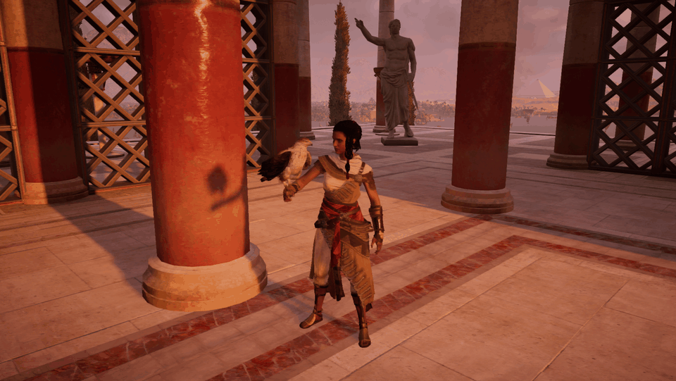


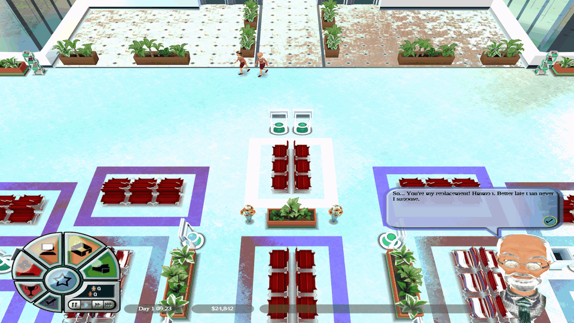


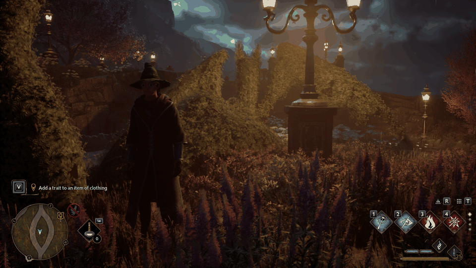
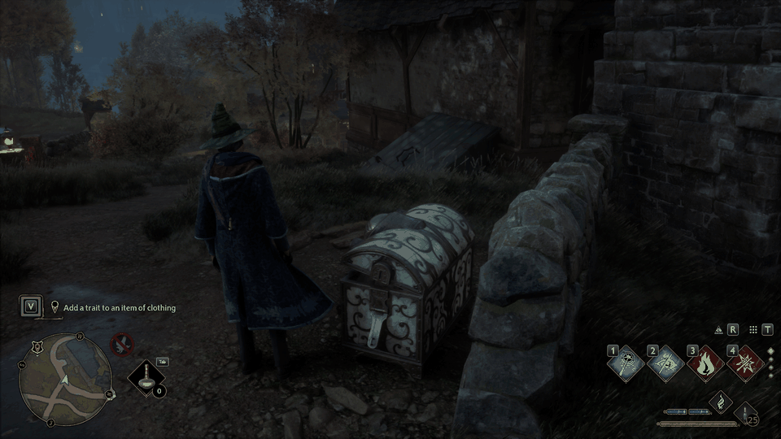
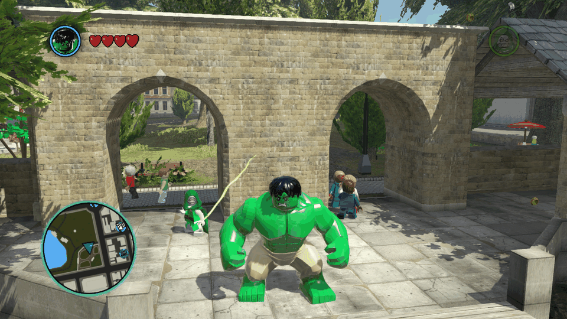
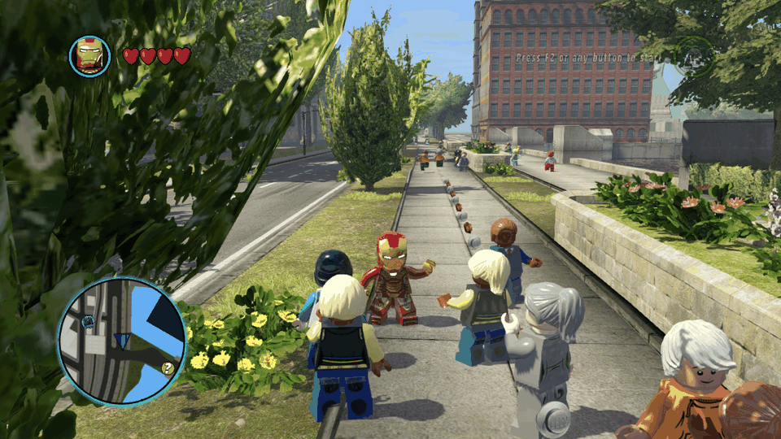
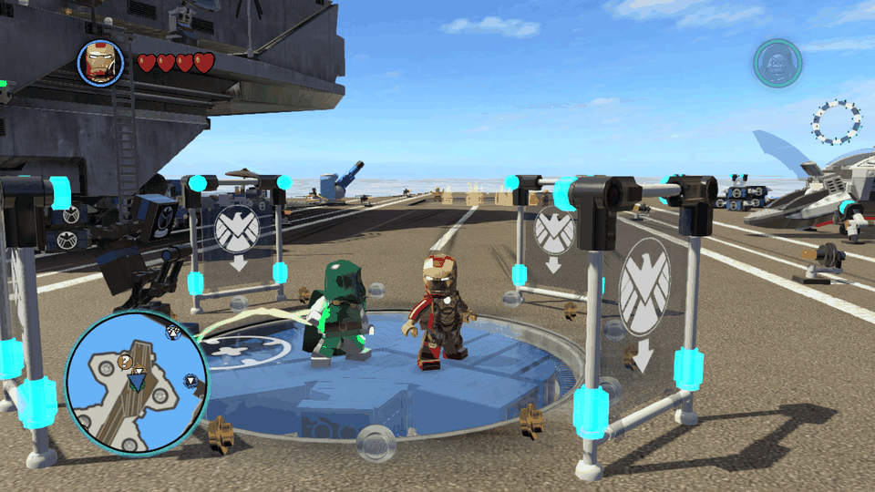
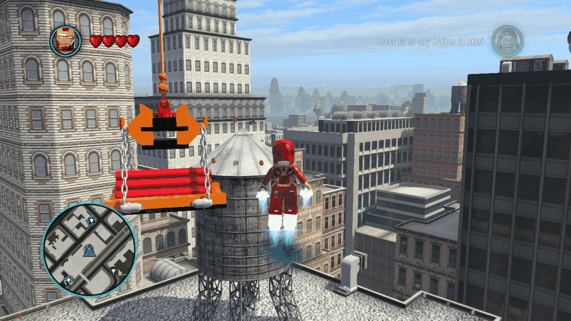
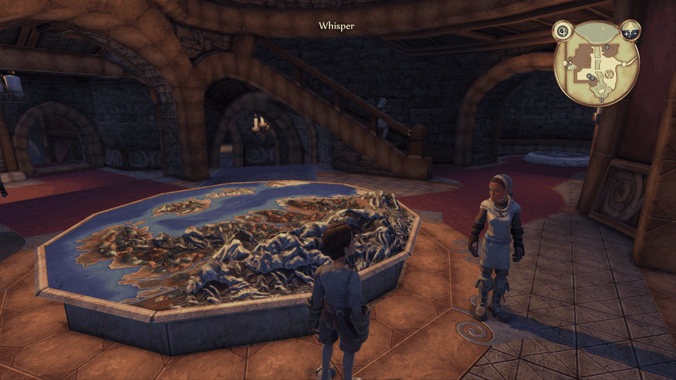
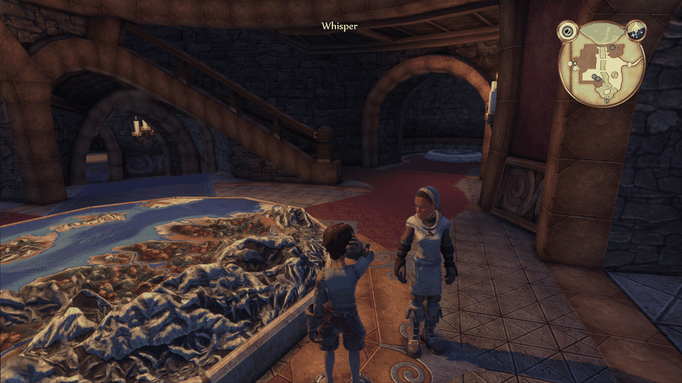
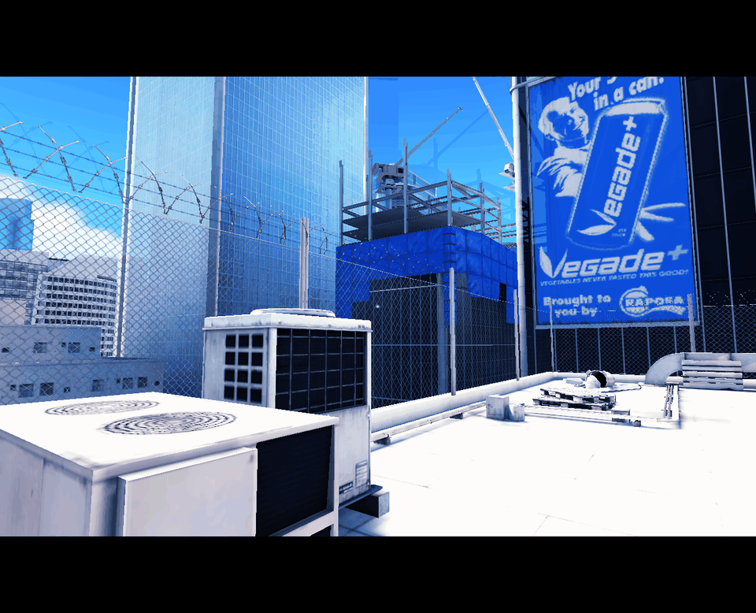
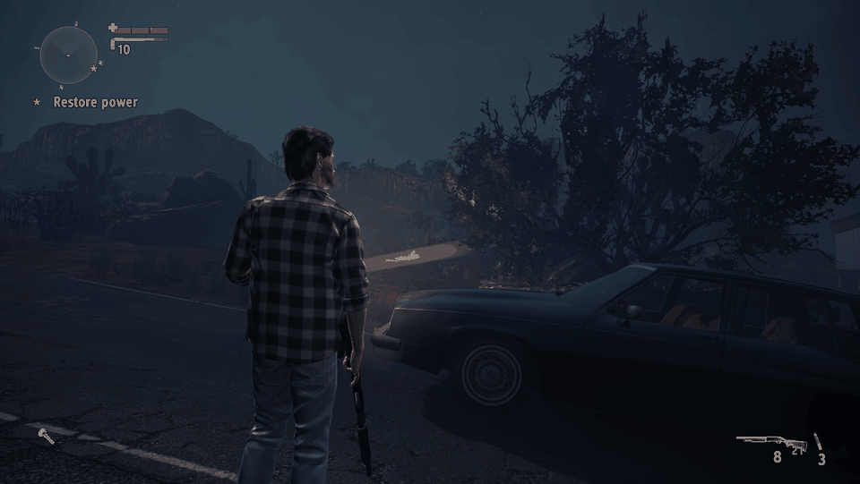
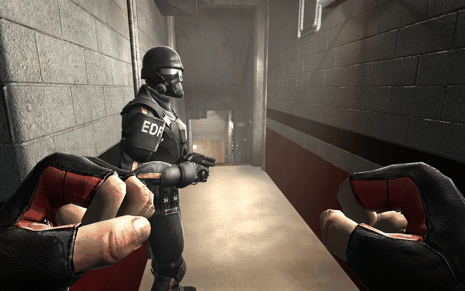
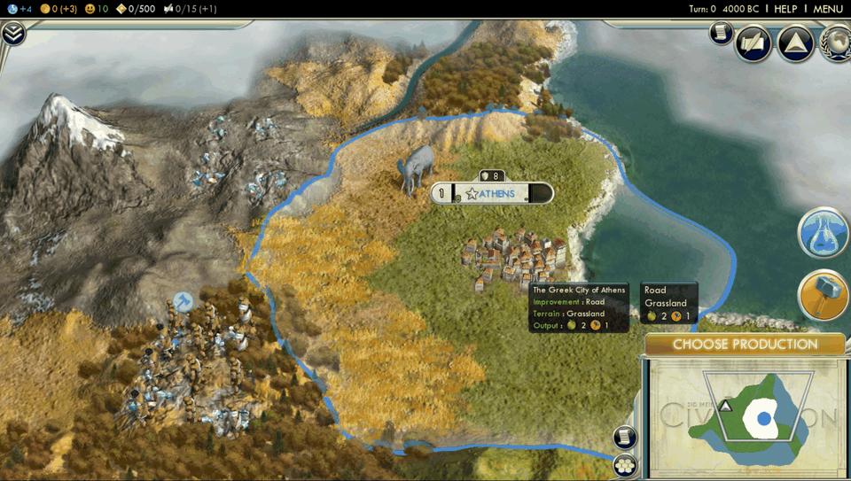
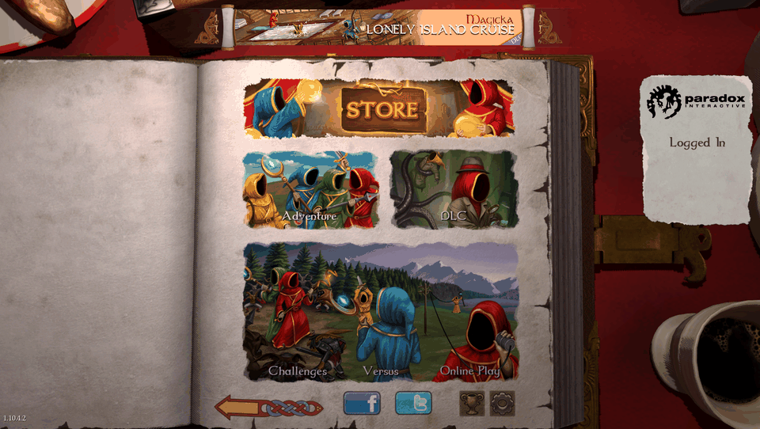
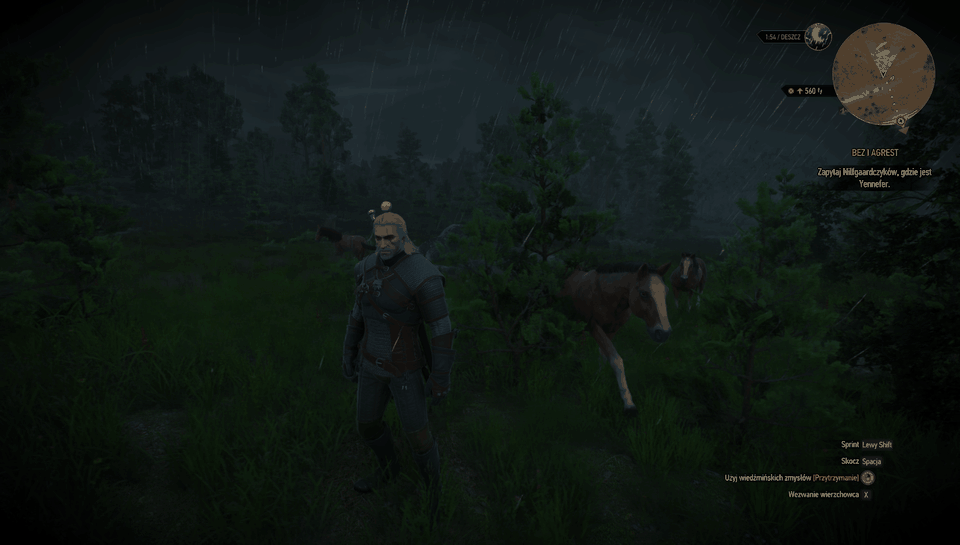

## Requirements

- Linux with a Vulkan driver (Mesa RADV, NVIDIA proprietary, …)
- Build tools: `make`, g++ (with 32-bit multilib for 32-bit games), python3,
  `glslc`, SDL3, Vulkan loader
- For the headset: WiVRn (server on the PC, app on the Quest)
- Steam: tested with the Flatpak

## Get it

`vrdual-<version>.tar.gz` of a release from
[Releases](https://github.com/adderek/vrdual/releases) (0.x are
pre-releases; GitHub's own "Source code" archives lack the Vulkan headers
submodule and do not build), or:

```bash
git clone --recursive https://github.com/adderek/vrdual
```

## Steam games

```bash
./vrdual build
./vrdual steam-install   # prints the launch option: .../vrdual/run %command%
./vrdual wivrn           # streaming server for the Quest (WiVRn app on the headset)
./vrdual xr              # game into the headset
./vrdual view            # optional: side by side window on the monitor
```

With one GPU the game window on the monitor flickers (it shows left and right
frames alternately); the headset is fine.

## Try it without a game

```bash
./_                  # menu
./vrdual demo        # test scene in stereo (window, side by side)
./vrdual calib       # IPD setup: arrows = IPD, W = save
./vrdual selftest    # does everything work? (exit 0 = yes)
./vrdual gpus        # what GPUs vrdual sees
```

Settings: `~/.config/vrdual/vrdual.conf` (`./vrdual config init`).

## Two GPUs (optional)

Both cards must be the same model and driver. Note: in most PCs the second
card sits behind the chipset with a slower link (e.g. PCIe Gen3 x4 instead of
Gen4 x16); check with `./vrdual gpus`.

## Tested

Hardware:

* 1x NVIDIA RTX 5070 Ti (single GPU)
* 2x AMD RX 7900 XTX

Games — per-game status, settings and tuning: [docs/GAMES.md](docs/GAMES.md).
Works in the headset: Zen Bound 2, Alice: Madness Returns, Portal 2, LEGO
Harry Potter 1-4, Tomb Raider III, Psychonauts, Mirror's Edge, Hospital
Tycoon. Broken: Portal (Zink bug), Tomb Raider I (DOSBox, 2D).

## Support

vrdual is developed in spare time. If it lets you play something in VR,
consider supporting it: [GitHub Sponsors](https://github.com/sponsors/adderek),
[Liberapay](https://liberapay.com/adderek/) or [Ko-fi](https://ko-fi.com/adderek).

When reporting a problem, include the output of `./vrdual version` (it also
shows whether Steam still loads an older layer) and the game's log.
`./vrdual report --open` opens a game report prefilled with the last game you
played and your system; `./vrdual request "Game" --open` asks for a game in
[Discussions](https://github.com/adderek/vrdual/discussions/categories/game-requests).
vrdual sends nothing itself: you see the form and submit it.

Hardware helps too: the only headset here is a Meta Quest 3S, so other
headsets (and their OpenXR runtimes) are untested. If you can lend or
donate one, please open an issue.

## License

[Apache License 2.0](LICENSE). Use, modify and redistribute freely, also
commercially; copies and derivative works must keep the copyright and the
[NOTICE](NOTICE) file, which names this project as the origin.

More: [docs/ARCHITECTURE.md](docs/ARCHITECTURE.md) · plan: [TODO.md](TODO.md) · for AI agents: [AGENTS.md](AGENTS.md)
