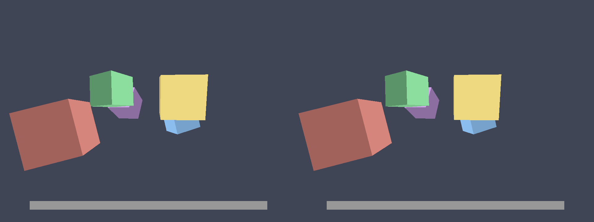

# vrdual — architecture and reference

Detailed reference. Entry points: [../README.md](../README.md) for humans,
[../AGENTS.md](../AGENTS.md) for agents. The option space and roadmap are in [PLAN.md](PLAN.md).



*Left eye rendered on the chipset GPU, right eye on the CPU-direct GPU, same
frame index. Near cube shifts ~25 px between eyes, far cubes ~0, the HUD bar
(w = 1) does not move.*

## Commands

```bash
./vrdual build | gpus | demo | calib | selftest | clean
./vrdual snapshot out.png 150                  # one paired SBS frame, no window
./vrdual run [--left-gpu G --right-gpu G --session S --snapshot PNG --at N] -- APP ARGS...
./vrdual config show [APP] | init | path
./vrdual live | set KEY VALUE | save [--global]
./vrdual steam-install                         # layer + wrapper for Steam; prints the launch option
./vrdual view [--session S]                    # SBS window (finds games inside Flatpak Steam)
./vrdual wivrn                                 # WiVRn streaming server (Flatpak, user install)
./vrdual xr [--session S] [--lock world|head]  # game in the HMD via OpenXR
./vrdual version                               # build identity of tools, build/ layers, installed copies
./vrdual games                                 # local play log (vrdual-xr writes it)
./vrdual request [GAME] [--open]               # ask for a game: GitHub Discussions URLs
./vrdual report [GAME] [--open]                # prefilled game-report issue form URL
```

Feedback (PLAN §M): `vrdual-xr` appends one line per game process to
`$XDG_STATE_HOME/vrdual/games.tsv` (default `~/.local/state/vrdual/`): start,
seconds with frames, app, GPU, profile (`config` / `built-in` / `none`). It
stays local. `request` and `report` only print prefilled GitHub URLs (GAME
defaults to the last logged game; field ids of `report` match
`.github/ISSUE_TEMPLATE/game-report.yml`); the user submits them, nothing is
sent by vrdual. A game without a profile gets a hint on stderr and in the
headset notice.

Build identity: every binary is compiled with `VRDUAL_BUILD_INFO`
(`tools/build_info.sh`, `common/vrdual_version.h`), e.g. `vrdual
v0.1.0-3-gabc1234-dirty, built 2026-10-21 18:05:09 +0200 on fractal`: `git
describe --tags --dirty --always` (releases are tags `v0.x.y`; outside git the
`VERSION` file, filled in by `git archive` through `export-subst`), the build time (ISO-8601; `SOURCE_DATE_EPOCH` for
reproducible release builds) and the build machine. The layer logs it once per
process (`… (64-bit layer)`), `vrdual-xr` at start, the tools on `--version`.

`vrdual` is the non-interactive CLI (stdout = data, prose on stderr, exit code =
result). `_` holds the implementation and adds a menu for humans. Build needs
`g++`, `glslc` (shaderc), `sdl3` and the Vulkan loader. `selftest` also needs
`spirv-val`, `magick` and `python3`. Vulkan headers are vendored in
`third_party/Vulkan-Headers` (submodule, tag v1.4.357), OpenXR headers in
`third_party/OpenXR-SDK` (release-1.1.65, headers only: `vrdual-xr` opens the
runtime itself, no loader). `make lib32` (part of `build`) needs gcc multilib
and the 32-bit GL/X11/Vulkan libs for the 32-bit layer and `vrdual-gltest`.

## Verified behaviour (2026-10-09)

Re-check all of it with `./vrdual selftest` (exit 0 = pass).

| what | how verified |
|---|---|
| App sees exactly one GPU, chosen per eye | `vrdual-cube` reports `app sees 1 GPU(s)`; layer logs the selected PCI address |
| Vertex shaders patched, pass `spirv-val` | GLSL (`gl_PerVertex` block) and HLSL (`SV_Position` variable) forms, `build/spvpatch` |
| Parallax matches theory | measured 25 px / 11 px for cubes at z≈1.5 / 3 (expected ≈20–26 / 10–12 incl. cube extent); HUD 0 px |
| Anchor modes left / right / center | logged per-eye offsets match the table below |
| Live IPD change, both GPUs, no restart | parallax 11 → 34 px for 66 → 200 mm (theory 10.6 → 32) |
| Near/far IPD blend | near cube ×2.6, farther cube ×2.25 with 64/200 mm |
| Config precedence + profile save | `vrdual config show` sources; `vrdual save` rewrites only its keys, keeps comments |
| Both eyes frame-locked across GPUs | compositor pairs L[F] with R[F]; live run: ~230 paired fps at 960×720, L−R lag ≤ 1 |

Added 2026-10-18:

| what | how verified |
|---|---|
| Mirror mode: one process, app sees one GPU, right eye replayed on the hidden GPU | selftest `mirror:*` (calib posts measured, live IPD) |
| Mirror under Zink, OpenGL 2.1-style app, 64- and 32-bit | selftest `mirror zink *` (`vrdual-gltest`, eyes differ) |
| Zen Bound 2 (32-bit, OpenGL, SDL 1.2) from Flatpak Steam, via the `run` wrapper | both eye files paired, ~50 fps at 1024×768, memory sync ≈1 ms/submit over 10 MB mapped; menu screens only (2D, so both eyes identical — no input automation to reach the 3D scene) |
| OpenXR output | selftest `openxr` against a local Monado build (simulated HMD, null compositor): session reaches FOCUSED, frames submitted. WiVRn 26.9: runtime loads, waits for a headset. Not seen in a real headset yet |

Not verified: in-headset image, 3D parallax inside a real game, Proton/DXVK titles.

## How it works

```
             ┌─ process A: APP ─ VK_LAYER_VRDUAL_stereo (eye=left,  GPU 06:00.0) ─┐
 same app ───┤                                                                     ├─ /dev/shm ─ vrdual-compositor ─ SBS window
             └─ process B: APP ─ VK_LAYER_VRDUAL_stereo (eye=right, GPU 0b:00.0) ─┘   (frame-paired)
```

The layer (`layer/vrdual_layer.cpp`) does four things:

1. **GPU filter** — `vkEnumeratePhysicalDevices{,Groups}` return only `VRDUAL_GPU`.
   The app never knows the other GPU exists.
2. **Eye offset** — every vertex shader gets `gl_Position.x += clip_dx` appended
   before each `OpReturn` (`layer/spirv_patch.hpp`). For a perspective projection
   P, moving the camera by *d* along view-space X changes clip X by exactly
   `-P[0][0]·d` and leaves clip W unchanged, so a constant clip offset is a true
   parallel-camera eye shift — no need to find the app's view matrix. (This is
   NVIDIA 3D Vision's "automatic" stereo trick with zero convergence, which is
   what an HMD wants.) Vertices with `w == 1` (HUD, full-screen post passes,
   orthographic shadow maps) are left alone (`VRDUAL_SKIP_W1`).
3. **Frame export** — at `vkQueuePresentKHR` the swapchain image is copied to a
   host buffer and published into a 4-slot seqlocked ring in `/dev/shm`.
4. **Lockstep** — frame N is held until the other eye has published N, so two
   deterministic processes stay frame-aligned.

## Mirror mode (one process, `VRDUAL_EYE=both`)

```
 APP ── VK_LAYER_VRDUAL_stereo ──┬─ device A (06:00.0, seen by the app) ─ left eye ──┐
        (generated wrappers)     └─ device B (0b:00.0, hidden, via ICD) ─ right eye ─┴─ /dev/shm ─ compositor / vrdual-xr
```

`layer/vrdual_mirror.hpp` + `build/mirror_gen.hpp` (generated by
`tools/gen_mirror.py` from `vk.xml`, ~400 wrappers).

- **Device B** is created straight through the Vulkan driver the loader already
  loaded (found with `dl_iterate_phdr`, `vk_icdGetInstanceProcAddr`): own
  VkInstance, same VkDeviceCreateInfo as the app's. The loader, other layers and
  the app never see it. Requires identical GPUs + driver (checked: memory types
  must match), so sizes, offsets and memory type indices carry over.
  **Single GPU:** when no other GPU matches `right_gpu` (one card, or
  `right_gpu` names the app's GPU) there is no twin: alternate-eye rendering
  on A. Frame 2F renders the left eye, 2F+1 the right (live params flipped
  after each present's readback, which already waited for that frame); both
  are published as pair F, so consumers pair them unchanged. Half the frame
  rate per eye, one frame of time between the eyes. Needs live params (baked
  → left eye only). A twin device on the same GPU cannot replay A's device
  addresses (NVIDIA: one GPU VA space per process, "vkAllocateMemory failed
  on B"), which breaks DXVK and Zink.
- **Replay**: every device-level call runs on A, then again on B with all
  handles translated (arrays, nested structs, pNext chains). Created handles
  are recorded A→B. Queries (`vkGet*`) run on A only. Untranslatable commands
  stop the mirror with a log line ("mirror STOPPED"), the app keeps running on A.
- **Host memory**: mappings are given to the app as a CPU shadow; at each
  submit/flush/unmap the changed 8-byte words go to A and B. Cached
  (readback, HOST_CACHED) memory too since 2026-10-21: its shadow starts as a
  copy of A at map time, and what A's GPU writes into host memory is copied
  back (below). After a
  mirror stop the shadows keep being copied to A (the app still writes them).
  Dirty tracking: shadows are registered with userfaultfd (async
  write-protect); each push asks `PAGEMAP_SCAN` for the pages written since
  the last one (re-protecting them in the same call) and diffs only those. A
  new mapping starts with one full diff. No kernel support (< 6.7), a sandbox
  refusing userfaultfd, or `VRDUAL_DIRTY=0`: full diff from the first changed
  page, as before.
  Write-back: the app reads GPU results (readback copies, fills, query
  results) from its shadow, so the commands that write host memory
  (`vkCmdCopyBuffer(2)`, `vkCmdCopyImageToBuffer(2)`, `vkCmdFillBuffer`,
  `vkCmdUpdateBuffer`, `vkCmdCopyQueryPoolResults`, secondaries via
  `vkCmdExecuteCommands`) are recorded per command buffer (hooks the generated
  wrappers call: `HOOKS_BEFORE` in `tools/gen_mirror.py`), a submit keeps
  their ranges with its fence (ours when the app passes none), and the calls
  through which the app learns of completion (fence wait/status/reset/destroy,
  timeline wait/value, queue/device wait idle) first copy those ranges from A
  into the shadow and into `last` (so B, whose GPU wrote its own result, is
  not overwritten). Shader stores into host memory are not tracked; a storage
  buffer (or storage texel buffer) placed in readback memory is logged once per
  allocation ("storage buffer in readback memory …"), so stale readbacks in a
  game point there (`VRDUAL_CACHED_SHADOW=0` as the workaround). Before
  2026-10-21 cached mappings were A's own (VM_PFNMAP: no userfaultfd), diffed
  in full: DXVK d3d9 keeps hundreds of MB there (CoJ Gunslinger: 288 MB, 23
  ms/submit); `VRDUAL_CACHED_SHADOW=0` brings that back. Tried and dropped
  2026-10-21: importing our own registered pages into A as the cached memory
  (`VK_EXT_external_memory_host`). amdgpu makes it a userptr BO; every
  write-protect fires its MMU notifier, the BO is revalidated with
  `hmm_range_fault` for write, which unprotects all its pages: scans then
  report ~100 MB "written" per submit (slower than the full diff), and B
  cannot always replay the userptr's device address. Superseded, still
  available (`cached_wp = 1`): cached mappings stay A's own and are made read-only per block (64 KB or
  more, ≤ 4096 blocks); the first write faults, a SIGSEGV handler (no libc,
  no TLS: Wine's segment registers) records the block and unprotects it;
  other faults go to the previous handler (Wine's). Kernel writes into a
  protected block (`read(2)` straight into the buffer) fail with EFAULT and
  the data never arrive (Wine retries only for its own mappings): Alice:
  Madness Returns streams textures that way and flickers black in both eyes.
  The shadow + write-back above is as fast without that bug
  (`vrdual-cube --verts-file` reproduces it, selftest). The log line `memory
  sync … MB mapped, … MB diffed; full diff … (… cached) …, dirty scan …,
  transient maps …, … cached write faults, … MB written back` shows where a
  push spends its time.
  32-bit processes (or `VRDUAL_TRANSIENT_MAPS=1`) map A-under-a-shadow and B
  only while a push copies changed pages: two persistent buffers per mapping
  instead of four, else large games exhaust the 4 GB address space (Alice
  Madness Returns: "out of memory for shadow mapping" during a 4K video).
- **Sync**: when the app learns that A finished work (fence wait/status,
  timeline wait/value), B is waited on too (5 s limit, else mirror stops), so B
  never reads memory the app already reuses.
- **WSI**: B has no swapchain. Swapchain images get plain B images as twins;
  acquire signals B's twin semaphore/fence with an empty submit; present copies
  the B image to frame file 1 under the same frame index as A's frame file 0.
- **Shaders**: modules are created separately per device, each patched with
  its own eye's parameter buffer (also inline modules in pipeline stages).
- **Pipelines**: B always compiles (`FAIL_ON_PIPELINE_COMPILE_REQUIRED` is
  stripped) — A may hit its cache where B would return no pipeline.
- **Device addresses** (DXVK 3 requires `bufferDeviceAddress`): memory and
  buffers with device-address usage are created with the capture/replay flags
  on A and replayed on B at A's opaque addresses, so every address the app
  writes into buffers or push constants is valid on both GPUs. Every
  `vkGetBufferDeviceAddress` is compared with B's; a mismatch stops the mirror.
  Needs `bufferDeviceAddressCaptureReplay` (RADV has it) and live params.
- **maintenance5/6**: visible in mirror mode (inline shader modules are
  patched on both devices; the *2 commands are plain replay). `vkMapMemory2`
  (core 1.4) maps like `vkMapMemory`.
- **Frame file owner**: all swapchains of a process share one frame file per
  eye (wined3d keeps several: helper windows, an old fullscreen one). It belongs
  to the biggest swapchain that presented within the last second; the others
  skip export. Claim and publish run under one lock (a re-map used to race a
  publish from another swapchain: SIGSEGV in Tomb Raider II).
- **Capability filter** (all stereo modes): hidden from the app are shader
  objects, descriptor buffers, external memory/semaphores, sparse, mesh
  shaders, ray tracing, host image copy, maintenance7+, present wait/id, ...
  (`ext_hidden`, `hide_features` in the layer); device addresses and
  maintenance5/6 as above. Zink and DXVK fall back to plain paths. The API version is not clamped (Zink refuses a 1.4 driver
  reporting 1.3; `VRDUAL_CLAMP_API=1` to force).
- Debug knobs: `VRDUAL_MIRROR_TRACE=N` (log first N mirrored calls),
  `VRDUAL_FILTER=0`, `VRDUAL_KEEP_EXT=...`, `VRDUAL_HIDE_FEATURES=0`, `VRDUAL_SHADOW=0`,
  `VRDUAL_TRANSIENT_MAPS=1`, `VRDUAL_DIRTY=0` (no dirty tracking),
  `VRDUAL_CACHED_SHADOW=0` (cached memory: A's own mapping, full diff), `VRDUAL_MIRROR_FAIL_AT=N` (stop the mirror at the
  Nth memory sync, for tests).

## Steam (Flatpak or native) and OpenGL games

`./vrdual steam-install` copies the 32- and 64-bit layer (`library_arch`
manifests) and a `run` wrapper to `~/.var/app/com.valvesoftware.Steam/vrdual`
(Flatpak; `~/vrdual` inside the sandbox) or `~/.local/share/vrdual`, and prints
the launch option `…/vrdual/run %command%`. The wrapper enables the layer in
mirror mode and sets `MESA_LOADER_DRIVER_OVERRIDE=zink`, so OpenGL games render
through Vulkan (Zink). The host config is copied next to it (`vrdual.conf`,
`VRDUAL_CONFIG` in the wrapper); the wrapper also sets `PROTON_LOG=1`
(`~/.var/app/com.valvesoftware.Steam/steam-<appid>.log`) and sends a native
game's stderr to `…/vrdual/game.log`.

Flatpak Steam has a private `/dev/shm` (host:
`/run/user/UID/.flatpak/com.valvesoftware.Steam/dev-shm`). Host tools take it
from `VRDUAL_SHM_DIR`; `vrdual view|live|set|save` set it automatically.
`vrdual xr` watches both (`VRDUAL_SHM_DIR=/dev/shm:<flatpak>`) and runs across
games: start it once; a new game process (frame header `producer`, v3)
reloads its settings. A game joining a control block left by an earlier one
re-seeds it from its own config at its first frame export (helper processes
without a swapchain, like Proton's xalia, leave it alone).

## HMD output (`vrdual-xr`, OpenXR)

One XrCompositionLayerProjection; each eye's frame is one view, with the FOV
the game rendered for (live `hfov`, vertical from the aspect).
`--lock world` (default): the picture is anchored in LOCAL space at a base
pose captured from the first valid view (between the eyes, roll removed, so
a tilted head at start doesn't tilt the screen; looking straight up/down the
yaw comes from the head's up vector, so lying down works). Menu held 1 s
re-captures the base from the current gaze. `--lock head` (films): VIEW
space, the picture follows the head; menu held 1 s freezes it in place
(anchored at the current gaze), again: follows again. Swapchains are 8-bit sRGB, filled by a buffer copy of the frame
bytes. The runtime is the active one (`~/.config/openxr/1/active_runtime.json`,
`XR_RUNTIME_JSON`), else `vrdual xr` uses WiVRn's Flatpak json.
When the newest game frame is older than 1 s (game exited) the eyes turn
black: submitting no layer is not enough, WiVRn's headset keeps the last
streamed image. Resumes when frames return. No layer while the view
orientation is invalid (headset off: zero quaternions fail `xrEndFrame`).

**Cinema screen** (`screen = flat | curved`, per game, from vorpX/FlatVR):
instead of the full-FOV projection, two layers on one surface `screen_fov`
wide at `screen_dist`, `eyeVisibility` LEFT/RIGHT, each with its eye's image:
`XrCompositionLayerQuad` (flat) or `XrCompositionLayerCylinderKHR` (curved,
radius = `screen_dist`; falls back to flat when the runtime lacks the
extension; WiVRn and Monado have it). The game's stereo then reads as a
window: objects at infinity sit on the screen plane. Base pose: VIEW origin
(head lock) or the start pose between the eyes (world lock). `aim` mode
intersects the controller ray with the plane/cylinder (full mode: direction
only, picture at infinity). One function (`screen_geom`) gives the picture's
pose and size for the layers and for aiming.

**Grab** (all screen modes; `ScreenGrab`, pure, in `vrdual_input.hpp`): both
grips held → the hands' midpoint drags the picture (not in full mode: at
infinity), the line between the hands turns it about its centre, their
distance scales it. The turn snaps to 15° steps of yaw / pitch / roll
relative to the base (level stays level); a trigger pressed during the grab turns freely until release. The
right stick stretches width (x) / height (y) at 50 %/s, the left stick
orbits the picture around the viewer (yaw / pitch about the base, 60°/s,
pitch ±80°). The game sees no grips, triggers or sticks meanwhile (the first
grip pressed gets a short press). Release logs offset, orbit and scale
(`screen_scale_x/y`); recentring (menu held) resets position, rotation and
orbit, keeps the scale. Quad/cylinder sub-images are inset 1 px: without it a
runtime sampling past the edge showed a seam at the cylinder's left/right
edge.

**Overlay** (`overlay_time` s, 0 = off): on events (headset connected,
game started / stopped, screen recentred or moved, `input = tune` changes) a
head-locked `XrCompositionLayerQuad` 1.5 m ahead shows the event, the game,
screen and input mode, ipd, world_scale, hud_depth and hfov. Drawn on the CPU
from a baked font (`common/vrdual_font.hpp`, `tools/gen_font.py`), uploaded
only when the text changes; after it expires one transparent image is sent
(WiVRn would keep showing the last one when no game layer follows).

**Cursor** (`cursor`, `cursor_depth`): games using the system (hardware)
cursor have none in their swapchain. The layer remembers the X11 window of
each `vkCreateXlibSurfaceKHR` / `vkCreateXcbSurfaceKHR` surface and, per
exported frame, asks the X server (its own xcb connection, libxcb +
libxcb-xfixes via dlopen: xcb reports errors per request, an Xlib error
handler would replace Wine's) for the pointer over that window, the window
size and the XFixes cursor image; three pipelined requests, one round trip.
Position (scaled to the swapchain), hotspot and image (≤ 64×64) go into the
frame header (v4, own seqlock). Under gamescope this is gamescope's
Xwayland. `vrdual-xr` blends the cursor into both eyes: `cursor_depth = auto`
finds the scene's disparity under the pointer by block matching a 25×25
patch between the two eye images (search along the eyes' shift factors,
rejects flat and repeating patches, smoothed, kept while no match), so the
cursor lies on the surface below it; `hud` puts it at `hud_depth`.

WiVRn (`vrdual wivrn`): Flatpak `io.github.wivrn.wivrn`. Without avahi-daemon
it must run with `--no-publish-service` (the wrapper adds it) and the headset
connects by IP; port 9757 TCP+UDP. `xrCreateInstance` blocks until a headset
is connected. `vrdual wivrn-restart` (or `vrdual xr --restart-wivrn`) stops
the server, waits for its lock and starts it in the background; a running
`vrdual xr` reconnects.

The server runs on `0000:0b:00.0` (`DRI_PRIME` for Mesa's device-select
layer; config key `wivrn_gpu`, `default` = Vulkan's choice), and
`vrdual-xr` follows it. AC Origins (smooth on the monitor) got 9.4 Hz in
the headset with the server on 06 and 10.2 Hz on 0b, so the GPU was not the
cause. The phase split in the stats showed the edge mask taking 89 ms per
frame: the staging buffers were write-combined memory and the mask reads
pixels back column by column. Staging now prefers HOST_CACHED (2026-10-26).

### Input and head motion (in `vrdual-xr`)

The game is identified by `app` in the frame file header (v2; VkApplicationInfo
name, else the exe), and its `[app:NAME]` settings select what the Touch
controllers (OpenXR actions, Touch profile) and the head do. Only while game
frames arrive; virtual devices via `/dev/uinput` (`common/vrdual_input.hpp`):

- `input = gamepad`: virtual Xbox 360 pad (045e:028e, SDL/Steam Input know it).
- `input = mouse`: mouse + keyboard; `mouse_mode` `stick` (right stick →
  velocity, `|x|^mouse_curve`), `motion` (right controller rotation → relative,
  left grip = clutch), `aim` (controller ray ∩ picture → absolute pointer
  device, maps to the whole desktop: best with fullscreen games). The menu
  button cycles the modes; left stick = WASD/arrows (`lstick`).
- `map_<button> = KEY_*|BTN_*|none` for a b x y l3 r3 lt rt lg rg menu.
- `head_look = mouse` (head yaw/pitch deltas × `head_counts_per_deg` → mouse)
  or `edge` (past `head_deadzone` from the start direction the angle sets a
  turn rate, `head_rate` deg/s at 45° past it). Menu held 1 s re-centres.
- `head_lean = on`: head position relative to the start (re-centred with the
  menu button), soft-clamped to `lean_max` (`L·tanh(d/L)`), written to the
  control block (`head_x/y/z`). The layer turns it into clip offsets for both
  eyes (x and y like the eye offset, forward via w with z scaled along so depth
  stays the same); y needs `lean_y_sign` (+1 GL/D3D games, −1 Vulkan apps that
  flip y in the projection). Render-only: the game's camera and collision stay.
  `vrdual set head_x 0.05` sets it by hand.

Stats, every 5 s in the `vrdual xr` log (`VRDUAL_XR_STATS` seconds): `N frames
submitted, M new game frames (game fps), headset … Hz, … without a new game
frame (repeats), frame age … ms avg / … max (layer publish -> upload), L-R …
ms` (publish skew of the two eyes), `per headset frame: xrWaitFrame … ms,
our work … ms avg / … max` (time blocked in the runtime's pacing vs our loop
from xrWaitFrame's return to after xrEndFrame, then split into phases: runtime
calls, input, pairing, staging copy, edge mask, cursor, swapchain acquire,
GPU upload, layers). The age starts when the layer publishes,
which with double-buffered readback is one game frame after it rendered.

Stereo window (`edge_mask`, default `outer`): an eye camera moved by dx shifts
its view by `−P00·dx/depth` (NDC), so at the eye's outer edge it shows a strip
the game never drew for its own camera (culled objects, pop-in, clear colour)
and near objects that the other eye does not see (flicker). `vrdual-xr`
blacks out that strip and fades the next one of the same width, per eye and
per frame from the control block (IPD, anchor, hfov, head lean). Width = the
shift of things at `edge_mask_dist` metres (`edge_band()`/`edge_mask()` in
`common/vrdual_frames.hpp`, both checked in `vrdual-input-test`).

Selftest's OpenXR check uses a Monado build at `build/monado/` (in-process
runtime, `XRT_FEATURE_SERVICE=OFF`; copy `libopenxr_monado.so` + a json there,
or point `VRDUAL_XR_TEST_RUNTIME` at one); skipped otherwise. `make clean`
keeps `build/monado/`. Rebuilding it here (no sudo; Eigen is header-only):

```bash
cd ~/.cache/vrdual
git clone --depth 1 -b 3.4.0 https://gitlab.com/libeigen/eigen.git eigen-src
cmake -S eigen-src -B eigen-build -DCMAKE_INSTALL_PREFIX=$PWD/eigen && cmake --install eigen-build
git clone --depth 1 https://gitlab.freedesktop.org/monado/monado.git monado-src
cmake -S monado-src -B monado-src/build -DXRT_FEATURE_SERVICE=OFF -DBUILD_TESTING=OFF \
  -DEigen3_DIR=$PWD/eigen/share/eigen3/cmake -DVulkan_INCLUDE_DIR=<vrdual>/third_party/Vulkan-Headers/include
cmake --build monado-src/build -j8 --target openxr_monado
# copy src/xrt/targets/openxr/libopenxr_monado.so to build/monado/, and
# openxr_monado-dev.json as build/monado/openxr_monado.json with
# "library_path": "./libopenxr_monado.so"
```

## Camera anchor and IPD

The app's original camera can be either eye or the midpoint:

| `anchor` | left eye at | right eye at |
|---|---|---|
| `center` (default) | −IPD/2 | +IPD/2 |
| `left` | 0 (original camera) | +IPD |
| `right` | −IPD | 0 (original camera) |

`clip_dx = −P00 · eye_dx · world_scale`, with `P00 = 1/tan(hfov/2)`. The layer
cannot see the app's projection, so `hfov` and `world_scale` (app units per
meter) are per-app guesses — that is what `[app:NAME]` profiles are for. A wrong
guess only scales the perceived IPD; geometry stays correct.

### Live IPD

The patched shader does not bake the offset in. It reads a `vec4` of eye
parameters through a buffer device address that the layer bakes into the shader
(`SPV_KHR_physical_storage_buffer`). The layer enables `bufferDeviceAddress` at
`vkCreateDevice` without the app knowing, and rewrites that buffer when the
session's control block (`/dev/shm/vrdual-<session>-ctl`) changes. No pipeline
rebuild is needed. Both GPUs pick up a change on the next frame. Verified:
IPD 66 → 200 mm on a running session moved a cube at z≈3 m from 11 px to 34 px
of parallax (theory 10.6 / 32), HUD still 0.
If the device lacks `bufferDeviceAddress`, or the app uses the old
`VK_EXT_buffer_device_address`, the layer falls back to baking the offset in
("BAKED", restart to apply).

### Near/far IPD (optional)

`ipd_near` blends in below `far_dist`, reaching `ipd_near` fully at `near_dist`:
`ipd(z) = mix(ipd, ipd_near, clamp((far_dist − z)/(far_dist − near_dist), 0, 1))`,
where z is view depth (clip W). Verified with exaggerated values (64 / 200 mm):
a near cube's parallax grew ×2.6 and a farther one ×2.25, as the blend predicts.

About the physiology: a measured "near PD" is normally 2–4 mm smaller than the
far PD. The eyes rotate inward to converge, so the pupils move closer, but the
eyes' rotation centres do not move. A renderer without eye tracking is
geometrically correct with one fixed IPD, the far one. So `ipd_near` is a
**perceptual** tweak: use it only if near objects still feel the wrong size or
distance after the far IPD is right. The one physical effect it partly mimics is
ocular parallax (the entrance pupil shifts ~1 mm per eye with gaze). Doing that
properly needs eye tracking.

## Configuration

`~/.config/vrdual/vrdual.conf` (or `$VRDUAL_CONFIG`). Precedence:
**defaults < `[global]` < `[app:NAME]` < `VRDUAL_<KEY>` env**. NAME matches the
app's `VkApplicationInfo.pApplicationName` or its exe basename, case-insensitive.

```ini
[global]
ipd = 0.064
left_gpu = pci:0000:06:00.0
right_gpu = pci:0000:0b:00.0

[app:SomeGame.exe]
hfov = 103
world_scale = 100      # engine works in centimeters
```

```bash
./vrdual config init               # commented default file
./vrdual config show SomeGame.exe  # effective value + where each came from
./vrdual live                      # running session's live values
./vrdual set ipd 64.5mm            # live change (also: ipd_near, near_dist, far_dist, anchor, hfov, world_scale)
./vrdual save                      # persist live values into the session app's profile (--global for [global])
```

All keys, values and environment variables: [CONFIG.md](CONFIG.md).

### Calibration UI

`./vrdual calib` runs a static scene with posts at 0.5, 1, 2, 5 and 20 m (equal
angular width) and opens the compositor with an overlay:

| key | action |
|---|---|
| Up / Down | far IPD ±0.5 mm (Shift: ±0.1 mm) |
| PgUp / PgDn | near IPD ±0.5 mm (Shift: ±0.1 mm) |
| N | near/far IPD on/off |
| `[` / `]` | near distance ∓0.1 m |
| A | anchor center → left → right |
| `-` / `=` | assumed HFOV ∓1° |
| W | save to the app's profile |
| S / H / Q | swap eyes / hide overlay / quit |

Procedure: set the far IPD first while looking at the 20 m post. It should fuse
effortlessly and feel far away, not like a small nearby toy. Then check the
0.5 m post. Only if it still feels wrong, enable N and tune the near IPD. The
same keys work in `./vrdual demo` and for any app started with `vrdual run`.
Honest caveat: until there is HMD output (M3), the SBS window only works for
free-viewing or a phone SBS viewer, so absolute IPD calibration is not
meaningful yet. The mechanism is done; the measurement needs the headset.

## Hardware note: one of the two GPUs is usually slower

On mainstream desktop boards only **one** x16 slot is wired to the CPU. The
second "x16" slot is physically x16 but electrically x4 and hangs off the
**chipset**, whose uplink to the CPU is shared with USB, SATA and M.2. Only
newer high-end boards (HEDT, or AM5/LGA1700 boards with x8/x8 CPU bifurcation)
give both GPUs CPU lanes. Check yours with `./vrdual gpus`. On this machine
(ASRock B550 PG Riptide):

| GPU | slot | narrowest link to CPU | notes |
|---|---|---|---|
| `0000:0b:00.0` | PCIE1, CPU-direct | **Gen4 x16** (~31.5 GB/s) | headless |
| `0000:06:00.0` | PCIE3, behind B550 chipset | **Gen3 x4** (~3.9 GB/s) — the card links at Gen4 but the chipset uplink is Gen3 x4 | hosts the desktop; no PCIe atomics |

The slot itself reports a cosmetic x16 — the bottleneck is upstream, which is
why `vrdual gpus` walks the bridge chain. Why it matters for VR:

- **Eye-frame transfer.** One eye must cross PCIe to reach the GPU driving the
  HMD. 2160×2160 RGBA8 = 18.7 MB/frame → 1.7 GB/s at 90 Hz, 2.2 GB/s at 120 Hz.
  That fits Gen3 x4 but uses roughly half of it, and there is no GPU-to-GPU P2P
  here, so it goes GPU → RAM → GPU.
- **Which GPU the app sees** (future, single-process mode): asset uploads and
  texture streaming go to that GPU first. Showing the app the fast GPU and
  putting the HMD there too is the likely default; the chipset GPU then only
  ships finished frames, one way. To be measured — see PLAN.md.
- The chipset GPU on this box also hosts the GNOME desktop, so its timings are
  noisier.

## Known PoC limitations (accepted)

- **Per-eye mode = two app instances.** Only deterministic apps line up; use
  mirror mode (`VRDUAL_EYE=both`) for games.
- **Mirror mode**: identical GPUs only; synchronous B waits make the app run at
  the slower GPU's pace; without dirty tracking the memory diff scans all
  mapped memory per submit (≈1 ms per 10 MB), cached mappings always; Wayland-native
  GL apps through Zink fail (hidden dma-buf/external memory), X11/XWayland ones
  work; GPU writes into host memory reach the app's reads only through the
  recorded copy/fill/query commands (write-back), not through shader stores.
- **Culling** is done by the app for its original camera; objects at the frustum
  edge can pop in one eye.
- **Near walls**: an eye displaced by IPD/2 can end up inside geometry the
  original camera is just outside of.
- **Post-processing / screen-space effects** that use view or projection matrices
  from uniform buffers (parallax occlusion mapping, SSR, SSAO, TAA reprojection,
  volumetrics) are not corrected and will disagree between eyes.
- **Perspective shadow maps** (spot/point lights) are also shifted, so shadows
  are slightly off. Orthographic (directional-light) shadow passes are spared by
  the `w == 1` rule.
- Only the vertex stage is patched: geometry/tessellation/mesh shaders, shader
  objects (`VK_EXT_shader_object`), inline modules (maintenance5) and pipeline
  binaries bypass it. Only Vulkan (DXVK/VKD3D-Proton games are Vulkan, in principle).
- A live IPD change lands mid-frame: draws already queued use the old value for
  one frame.
- Compositor keys were exercised through the same code path as `vrdual-ctl set`,
  but not by pressing keys in a window (no display automation here).
- Readback at present is double-buffered: frame N's copy runs on the GPU while
  frame N-1 is published (one frame later in the frame files; the game no
  longer waits for its copy). testapp 1920x1080 mirror: 6.6 -> 4.0 ms per
  frame; what is left is mostly GPU A's PCIe x4 link moving 8 MB per frame
  (~2.4 ms of GPU time, in the background; at 90 fps ~20 % of the link) and
  ~0.8 ms of CPU copies into /dev/shm. Alternate-eye rendering (one GPU)
  still waits for its copy: the eye params flip only after the frame.
  Swapchains: 8-bit RGBA/BGRA
  copied as they are; 10-bit UNORM (A2B10G10R10/A2R10G10B10, what UE4 picks
  even with HDR off) and FP16 are blitted into an 8-bit image first (FP16 into
  sRGB, which encodes its linear values); HDR colour spaces are not tone-mapped
  (logged). The biggest swapchain is exported.
